# Indian Banks

Structured, centralized data, including logos for all the Indian Banks, collected from official sources.

## Sponsorship & Contribution

If you or your organization uses this repository for bank related data, please consider sponsoring me. It has taken me hours of work to get high quality vectors right and source data from multiple places after a lot of manual verification.

As you can imagine, this is a time consuming effort and it would be amazing if you can [contribute](./CONTRIBUTING.md) to this repository.

## Current Status

- [ ] Vector Logos - In Progress
- [ ] Figuring out the base data structure - In Progress
  - Name
  - Logo
  - Symbol / Small Logo
  - Short Code
  - IFSC Prefix
  - Balance Check USSD Code
  - Website
  - Type : https://www.rbi.org.in/scripts/banklinks.aspx
- [ ] How to scrape names & other details from official websites.

## Bank Slugs

| Bank Name                        | Slug   | Logo                                                    | Symbol                                                    |
| -------------------------------- | ------ | ------------------------------------------------------- | --------------------------------------------------------- |
| Airtel Payments Bank             | `airp` |  |  |
| AU Small Finance Bank Limited    | `aubl` | 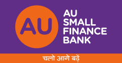 |  |
| Bank of Baroda                   | `barb` | 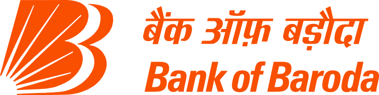 | 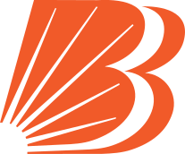 |
| Bandhan Bank                     | `bdbl` |  |  |
| Bank of India                    | `bkid` | 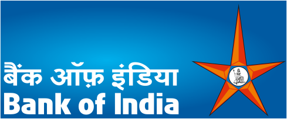 |  |
| Central Bank Of India            | `cbin` | 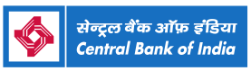 |  |
| City Union Bank                  | `ciub` |  |  |
| Canara Bank                      | `cnrb` |  |  |
| CSB Bank Limited                 | `csbk` |  |  |
| DCB Bank Limited                 | `dcbl` |  |  |
| Dhanalakshmi Bank                | `dlxb` |  |  |
| ESAF Small Finance Bank          | `esmf` | 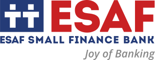 | 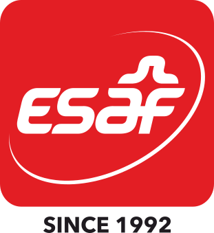 |
| Federal Bank                     | `fdrl` | 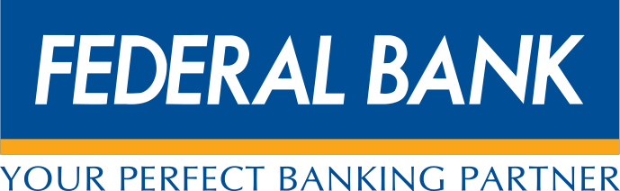 |  |
| HDFC Bank                        | `hdfc` |  |  |
| IDBI Bank                        | `ibkl` |  |  |
| ICICI Bank Limited               | `icic` |  |  |
| IDFC First Bank Limited          | `idfb` |  |  |
| Indian Bank                      | `idib` | 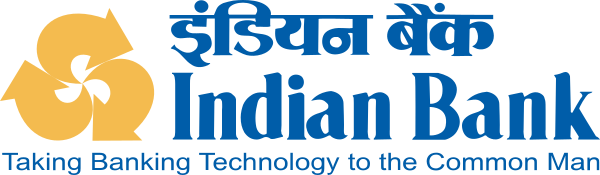 |  |
| Indusind Bank                    | `indb` |  |  |
| Indian Overseas Bank             | `ioba` |  |  |
| Jio Payments Bank                | `jiop` |  | 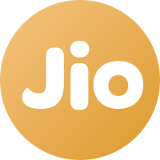 |
| Jammu and Kashmir Bank           | `jaka` |  |  |
| Karnataka Bank Limited           | `karb` |  |  |
| Kotak Mahindra Bank Limited      | `kkbk` |  |  |
| Karur Vysya Bank                 | `kvbl` | 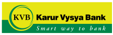 | 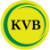 |
| Bank of Maharashtra              | `mahb` |  |  |
| The Nainital Bank Limited        | `ntbl` | 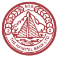 |  |
| Paytm Payments Bank              | `pytm` |  |  |
| Punjab and Sind Bank             | `psib` | 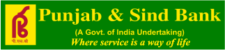 |  |
| Punjab National Bank             | `punb` | 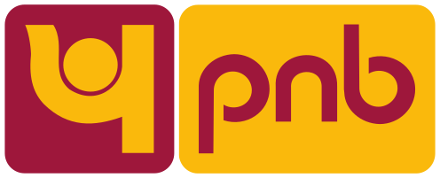 |  |
| RBL Bank Limited                 | `ratn` |  |  |
| South Indian Bank                | `sibl` |  |  |
| Standard Chartered Bank          | `scbl` | 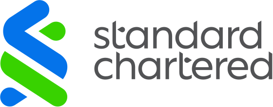 |  |
| State Bank of India              | `sbin` |  |  |
| Tamilnad Mercantile Bank Limited | `tmbl` | 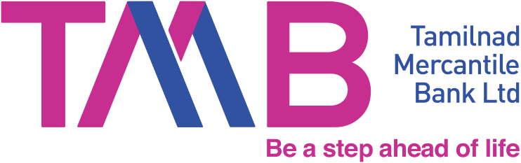 | 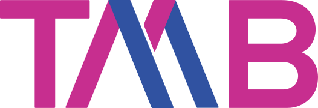 |
| Ujjivan Small Finance Bank Ltd   | `ujvn` |  |  |
| Union Bank of India              | `ubin` |  |  |
| UCO Bank                         | `ucba` |  |  |
| Axis Bank                        | `utib` |  |  |
| Yes Bank                         | `yesb` |  |  |

## Optimizing & Converting

Optimize SVGs (preserves `viewBox`):

```sh
pnpm install
pnpm run optimize
```

Convert each SVG to PNG for cases where SVG isn't supported:

```sh
brew install inkscape
./convert.sh
```

## Contributors
<a href="https://github.com/praveenpuglia/indian-banks/graphs/contributors">
  
</a>

Made with [contrib.rocks](https://contrib.rocks).
