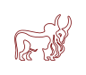
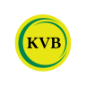
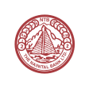
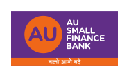
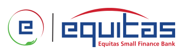
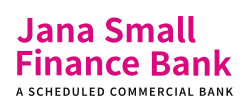
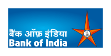
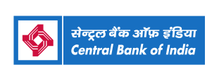
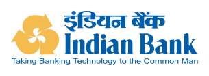
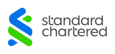

# Indian Banks

Structured, centralized data, including logos for all the Indian Banks, collected from official sources.

## Using the logos

Every bank has a folder named after its **slug**, which is the lowercase IFSC prefix (`HDFC0000001` → `hdfc`). Find yours in the [table below](#bank-slugs), then point at the files directly over jsDelivr:

```
https://cdn.jsdelivr.net/gh/praveenpuglia/indian-banks/assets/logos/<slug>/logo.svg
https://cdn.jsdelivr.net/gh/praveenpuglia/indian-banks/assets/logos/<slug>/symbol.svg
```

Need a raster image (emails, native apps, places that don't take SVG)? Swap the extension. PNGs are rendered at the SVG's intrinsic size:

```
https://cdn.jsdelivr.net/gh/praveenpuglia/indian-banks/assets/logos/<slug>/logo.png
https://cdn.jsdelivr.net/gh/praveenpuglia/indian-banks/assets/logos/<slug>/symbol.png
```

```html

```

Each folder has a `logo` (full wordmark) and a `symbol` (square mark). A few banks have only one of the two, or a PNG with no SVG; the table below shows exactly what exists. The slug → bank name map is at [`data/banks.json`](https://cdn.jsdelivr.net/gh/praveenpuglia/indian-banks/data/banks.json), and the bank type for each slug is in [`data/types.json`](https://cdn.jsdelivr.net/gh/praveenpuglia/indian-banks/data/types.json).

## Sponsorship & Contribution

If you or your organization uses this repository for bank related data, please consider sponsoring me. It has taken me hours of work to get high quality vectors right and source data from multiple places after a lot of manual verification.

As you can imagine, this is a time consuming effort and it would be amazing if you can [contribute](./CONTRIBUTING.md) to this repository.

## Bank Slugs

Click a logo to open the source file. The previews sit on white cards so they stay readable in dark mode; the files themselves have transparent backgrounds. Banks still missing are tracked in [logos-progress.md](./logos-progress.md).

This table is auto-generated from [data/banks.json](./data/banks.json) and the contents of [assets/logos/](./assets/logos/) on every commit that touches either. To regenerate manually, run `pnpm run generate:readme`.

<!-- BANKS_TABLE_START -->
[Private Sector Banks](#private-sector-banks) (21) · [Small Finance Banks](#small-finance-banks) (11) · [Payments Banks](#payments-banks) (5) · [Public Sector Banks](#public-sector-banks) (12) · [Foreign Banks](#foreign-banks) (1)

### Private Sector Banks

| Bank Name | Slug | Logo | Symbol |
| --- | --- | --- | --- |
| [Axis Bank](./assets/logos/utib/) | `utib` | <a href="./assets/logos/utib/logo.svg"></a> | <a href="./assets/logos/utib/symbol.svg"></a> |
| [Bandhan Bank](./assets/logos/bdbl/) | `bdbl` | <a href="./assets/logos/bdbl/logo.svg"></a> | <a href="./assets/logos/bdbl/symbol.svg"></a> |
| [City Union Bank](./assets/logos/ciub/) | `ciub` | <a href="./assets/logos/ciub/logo.svg"></a> | <a href="./assets/logos/ciub/symbol.svg"></a> |
| [CSB Bank Limited](./assets/logos/csbk/) | `csbk` | <a href="./assets/logos/csbk/logo.svg"></a> | <a href="./assets/logos/csbk/symbol.svg"></a> |
| [DCB Bank Limited](./assets/logos/dcbl/) | `dcbl` | <a href="./assets/logos/dcbl/logo.svg"></a> | <a href="./assets/logos/dcbl/symbol.svg"></a> |
| [Dhanalakshmi Bank](./assets/logos/dlxb/) | `dlxb` | <a href="./assets/logos/dlxb/logo.svg"></a> | <a href="./assets/logos/dlxb/symbol.svg"></a> |
| [Federal Bank](./assets/logos/fdrl/) | `fdrl` | <a href="./assets/logos/fdrl/logo.svg"></a> | <a href="./assets/logos/fdrl/symbol.svg"></a> |
| [HDFC Bank](./assets/logos/hdfc/) | `hdfc` | <a href="./assets/logos/hdfc/logo.svg"></a> | <a href="./assets/logos/hdfc/symbol.svg"></a> |
| [ICICI Bank Limited](./assets/logos/icic/) | `icic` | <a href="./assets/logos/icic/logo.svg"></a> | <a href="./assets/logos/icic/symbol.svg"></a> |
| [IDBI Bank](./assets/logos/ibkl/) | `ibkl` | <a href="./assets/logos/ibkl/logo.svg"></a> | <a href="./assets/logos/ibkl/symbol.svg"></a> |
| [IDFC First Bank Limited](./assets/logos/idfb/) | `idfb` | <a href="./assets/logos/idfb/logo.svg"></a> | <a href="./assets/logos/idfb/symbol.svg"></a> |
| [IndusInd Bank](./assets/logos/indb/) | `indb` | <a href="./assets/logos/indb/logo.svg"></a> | <a href="./assets/logos/indb/symbol.svg"></a> |
| [Jammu and Kashmir Bank](./assets/logos/jaka/) | `jaka` | <a href="./assets/logos/jaka/logo.svg"></a> | <a href="./assets/logos/jaka/symbol.svg"></a> |
| [Karnataka Bank Limited](./assets/logos/karb/) | `karb` | <a href="./assets/logos/karb/logo.svg"></a> | <a href="./assets/logos/karb/symbol.svg"></a> |
| [Karur Vysya Bank](./assets/logos/kvbl/) | `kvbl` | <a href="./assets/logos/kvbl/logo.svg"></a> | <a href="./assets/logos/kvbl/symbol.svg"></a> |
| [Kotak Mahindra Bank Limited](./assets/logos/kkbk/) | `kkbk` | <a href="./assets/logos/kkbk/logo.svg"></a> | <a href="./assets/logos/kkbk/symbol.svg"></a> |
| [RBL Bank Limited](./assets/logos/ratn/) | `ratn` | <a href="./assets/logos/ratn/logo.svg"></a> | <a href="./assets/logos/ratn/symbol.svg"></a> |
| [South Indian Bank](./assets/logos/sibl/) | `sibl` | <a href="./assets/logos/sibl/logo.svg"></a> | <a href="./assets/logos/sibl/symbol.svg"></a> |
| [Tamilnad Mercantile Bank Limited](./assets/logos/tmbl/) | `tmbl` | <a href="./assets/logos/tmbl/logo.svg"></a> | <a href="./assets/logos/tmbl/symbol.svg"></a> |
| [The Nainital Bank Limited](./assets/logos/ntbl/) | `ntbl` | <a href="./assets/logos/ntbl/logo.svg"></a> | <a href="./assets/logos/ntbl/symbol.svg"></a> |
| [Yes Bank](./assets/logos/yesb/) | `yesb` | <a href="./assets/logos/yesb/logo.svg"></a> | <a href="./assets/logos/yesb/symbol.svg"></a> |

### Small Finance Banks

| Bank Name | Slug | Logo | Symbol |
| --- | --- | --- | --- |
| [AU Small Finance Bank Limited](./assets/logos/aubl/) | `aubl` | <a href="./assets/logos/aubl/logo.svg"></a> | <a href="./assets/logos/aubl/symbol.svg"></a> |
| [Capital Small Finance Bank](./assets/logos/clbl/) | `clbl` | <a href="./assets/logos/clbl/logo.svg"></a> | <a href="./assets/logos/clbl/symbol.svg"></a> |
| [Equitas Small Finance Bank](./assets/logos/esfb/) | `esfb` | <a href="./assets/logos/esfb/logo.svg"></a> | <a href="./assets/logos/esfb/symbol.svg"></a> |
| [ESAF Small Finance Bank](./assets/logos/esmf/) | `esmf` | <a href="./assets/logos/esmf/logo.svg"></a> | <a href="./assets/logos/esmf/symbol.svg"></a> |
| [Jana Small Finance Bank](./assets/logos/jsfb/) | `jsfb` | <a href="./assets/logos/jsfb/logo.svg"></a> | <a href="./assets/logos/jsfb/symbol.svg"></a> |
| [Shivalik Small Finance Bank](./assets/logos/smcb/) | `smcb` | <a href="./assets/logos/smcb/logo.svg"></a> | <a href="./assets/logos/smcb/symbol.svg"></a> |
| [slice Small Finance Bank](./assets/logos/nesf/) | `nesf` | <a href="./assets/logos/nesf/logo.svg"></a> | <a href="./assets/logos/nesf/symbol.svg"></a> |
| [Suryoday Small Finance Bank](./assets/logos/sury/) | `sury` | <a href="./assets/logos/sury/logo.svg"></a> | <a href="./assets/logos/sury/symbol.svg"></a> |
| [Ujjivan Small Finance Bank Ltd](./assets/logos/ujvn/) | `ujvn` | <a href="./assets/logos/ujvn/logo.svg"></a> | <a href="./assets/logos/ujvn/symbol.svg"></a> |
| [Unity Small Finance Bank](./assets/logos/unba/) | `unba` | <a href="./assets/logos/unba/logo.svg"></a> | <a href="./assets/logos/unba/symbol.svg"></a> |
| [Utkarsh Small Finance Bank](./assets/logos/utks/) | `utks` | <a href="./assets/logos/utks/logo.svg"></a> | <a href="./assets/logos/utks/symbol.svg"></a> |

### Payments Banks

| Bank Name | Slug | Logo | Symbol |
| --- | --- | --- | --- |
| [Airtel Payments Bank](./assets/logos/airp/) | `airp` | <a href="./assets/logos/airp/logo.svg"></a> | <a href="./assets/logos/airp/symbol.svg"></a> |
| [FINO Payments Bank](./assets/logos/fino/) | `fino` | <a href="./assets/logos/fino/logo.svg"></a> | <a href="./assets/logos/fino/symbol.svg"></a> |
| [India Post Payments Bank](./assets/logos/ipos/) | `ipos` | <a href="./assets/logos/ipos/logo.svg"></a> | <a href="./assets/logos/ipos/symbol.svg"></a> |
| [Jio Payments Bank](./assets/logos/jiop/) | `jiop` | <a href="./assets/logos/jiop/logo.svg"></a> | <a href="./assets/logos/jiop/symbol.svg"></a> |
| [Paytm Payments Bank](./assets/logos/pytm/) | `pytm` | <a href="./assets/logos/pytm/logo.svg"></a> | <a href="./assets/logos/pytm/symbol.svg"></a> |

### Public Sector Banks

| Bank Name | Slug | Logo | Symbol |
| --- | --- | --- | --- |
| [Bank of Baroda](./assets/logos/barb/) | `barb` | <a href="./assets/logos/barb/logo.svg"></a> | <a href="./assets/logos/barb/symbol.svg"></a> |
| [Bank of India](./assets/logos/bkid/) | `bkid` | <a href="./assets/logos/bkid/logo.svg"></a> | <a href="./assets/logos/bkid/symbol.svg"></a> |
| [Bank of Maharashtra](./assets/logos/mahb/) | `mahb` | <a href="./assets/logos/mahb/logo.svg"></a> | <a href="./assets/logos/mahb/symbol.svg"></a> |
| [Canara Bank](./assets/logos/cnrb/) | `cnrb` | <a href="./assets/logos/cnrb/logo.svg"></a> | <a href="./assets/logos/cnrb/symbol.svg"></a> |
| [Central Bank of India](./assets/logos/cbin/) | `cbin` | <a href="./assets/logos/cbin/logo.svg"></a> | <a href="./assets/logos/cbin/symbol.svg"></a> |
| [Indian Bank](./assets/logos/idib/) | `idib` | <a href="./assets/logos/idib/logo.svg"></a> | <a href="./assets/logos/idib/symbol.svg"></a> |
| [Indian Overseas Bank](./assets/logos/ioba/) | `ioba` | <a href="./assets/logos/ioba/logo.svg"></a> | <a href="./assets/logos/ioba/symbol.svg"></a> |
| [Punjab and Sind Bank](./assets/logos/psib/) | `psib` | <a href="./assets/logos/psib/logo.svg"></a> | <a href="./assets/logos/psib/symbol.svg"></a> |
| [Punjab National Bank](./assets/logos/punb/) | `punb` | <a href="./assets/logos/punb/logo.svg"></a> | <a href="./assets/logos/punb/symbol.svg"></a> |
| [State Bank of India](./assets/logos/sbin/) | `sbin` | <a href="./assets/logos/sbin/logo.svg"></a> | <a href="./assets/logos/sbin/symbol.svg"></a> |
| [UCO Bank](./assets/logos/ucba/) | `ucba` | <a href="./assets/logos/ucba/logo.svg"></a> | <a href="./assets/logos/ucba/symbol.svg"></a> |
| [Union Bank of India](./assets/logos/ubin/) | `ubin` | <a href="./assets/logos/ubin/logo.svg"></a> | <a href="./assets/logos/ubin/symbol.svg"></a> |

### Foreign Banks

| Bank Name | Slug | Logo | Symbol |
| --- | --- | --- | --- |
| [Standard Chartered Bank](./assets/logos/scbl/) | `scbl` | <a href="./assets/logos/scbl/logo.svg"></a> | <a href="./assets/logos/scbl/symbol.svg"></a> |
<!-- BANKS_TABLE_END -->

## Optimizing & Converting

Optimize SVGs (preserves `viewBox`):

```sh
pnpm install
pnpm run optimize
```

Convert SVGs to PNG or AVIF. By default, writes 1x PNGs alongside each SVG in `assets/logos/`:

```sh
pnpm run convert
```

We ship 1x PNGs alongside every SVG. If you need AVIF or higher-density variants, pass a format, scale factor, and output directory:

```sh
# 2x AVIFs into ./dist
pnpm run convert -- --format avif --scale 2 --out dist
```

**Flags**

| Flag              | Values       | Default           | Notes                                        |
| ----------------- | ------------ | ----------------- | -------------------------------------------- |
| `-f`, `--format`  | `png`, `avif`| `png`             |                                              |
| `-s`, `--scale`   | `1`, `2`, `3`| `1`               | 1x uses intrinsic SVG dimensions             |
| `-o`, `--out`     | any dir      | `assets/logos/`   | If omitted, overwrites files in the repo     |

Output is named `logo.png` at 1x, `logo@2x.png` at 2x, `logo@3x.png` at 3x (and the same pattern for AVIF).

## Contributors
<a href="https://github.com/praveenpuglia/indian-banks/graphs/contributors">
  
</a>

Made with [contrib.rocks](https://contrib.rocks).
