# Indian Banks

Structured, centralized data, including logos for all the Indian Banks, collected from official sources.

## Sponsorship & Contribution

If you or your organization uses this repository for bank related data, please consider sponsoring me. It has taken me hours of work to get high quality vectors right and source data from multiple places after a lot of manual verification.

As you can imagine, this is a time consuming effort and it would be amazing if you can [contribute](./CONTRIBUTING.md) to this repository.

## Current Status

- [ ] Vector Logos - In Progress
- [ ] Figuring out the base data structure - In Progress
  - Name
  - Logo
  - Symbol / Small Logo
  - Short Code
  - IFSC Prefix
  - Balance Check USSD Code
  - Website
  - Type : https://www.rbi.org.in/scripts/banklinks.aspx
- [ ] How to scrape names & other details from official websites.

## Bank Slugs

This table is auto-generated from [data/banks.json](./data/banks.json) and the contents of [assets/logos/](./assets/logos/) on every commit that touches either. To regenerate manually, run `pnpm run generate:readme`.

<!-- BANKS_TABLE_START -->
| Bank Name | Slug | Logo | Symbol |
| --- | --- | --- | --- |
| [AB Bank PLC](./assets/logos/ab-bank/) | `ab-bank` | 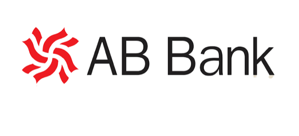<br/>`PNG` | — |
| [ABN AMRO Bank N.V.](./assets/logos/abna/) | `abna` | — | <br/>`PNG` |
| [Abu Dhabi Commercial Bank](./assets/logos/adcb/) | `adcb` | — | <br/>`PNG` |
| [Airtel Payments Bank](./assets/logos/airp/) | `airp` | <br/>`SVG` `PNG` | <br/>`SVG` `PNG` |
| [American Express Banking Corporation](./assets/logos/amex/) | `amex` | <br/>`PNG` | — |
| [Australia and New Zealand Banking Group Limited](./assets/logos/anzb/) | `anzb` | — | <br/>`PNG` |
| [Andhra Pradesh Grameena Bank](./assets/logos/ap-grameena/) | `ap-grameena` | 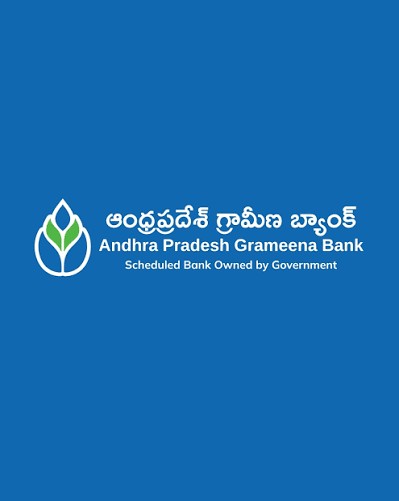<br/>`PNG` | — |
| [Arunachal Pradesh Rural Bank](./assets/logos/arunachal-rural/) | `arunachal-rural` | <br/>`PNG` | — |
| [Assam Gramin Bank](./assets/logos/assam-gramin/) | `assam-gramin` | 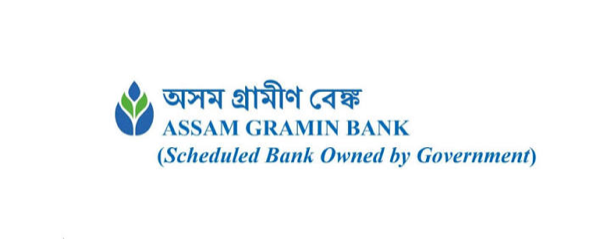<br/>`PNG` | — |
| [AU Small Finance Bank Limited](./assets/logos/aubl/) | `aubl` | <br/>`SVG` `PNG` | <br/>`SVG` `PNG` |
| [Bank of Baroda](./assets/logos/barb/) | `barb` | <br/>`SVG` `PNG` | <br/>`SVG` `PNG` |
| [Barclays Bank](./assets/logos/barc/) | `barc` | — | <br/>`PNG` |
| [Bank of Bahrain and Kuwait](./assets/logos/bbkm/) | `bbkm` | — | <br/>`PNG` |
| [Bank of Ceylon](./assets/logos/bcey/) | `bcey` | — | 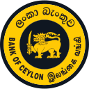<br/>`PNG` |
| [Bank of China](./assets/logos/bchn/) | `bchn` | — | <br/>`PNG` |
| [Bandhan Bank](./assets/logos/bdbl/) | `bdbl` | <br/>`SVG` `PNG` | <br/>`SVG` `PNG` |
| [Bihar Gramin Bank](./assets/logos/bihar-gramin/) | `bihar-gramin` | 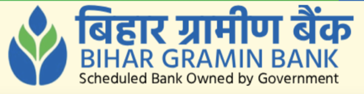<br/>`PNG` | — |
| [Bank of India](./assets/logos/bkid/) | `bkid` | <br/>`SVG` `PNG` | <br/>`SVG` `PNG` |
| [BNP Paribas](./assets/logos/bnpa/) | `bnpa` | — | <br/>`PNG` |
| [Bank of America](./assets/logos/bofa/) | `bofa` | — | <br/>`PNG` |
| [MUFG Bank Ltd](./assets/logos/botm/) | `botm` | — | <br/>`PNG` |
| [Central Bank of India](./assets/logos/cbin/) | `cbin` | <br/>`SVG` `PNG` | <br/>`SVG` `PNG` |
| [J.P. Morgan Chase Bank N.A.](./assets/logos/chas/) | `chas` | 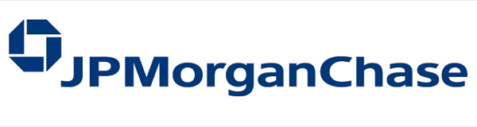<br/>`PNG` | — |
| [Chhattisgarh Gramin Bank](./assets/logos/chhattisgarh-gramin/) | `chhattisgarh-gramin` | 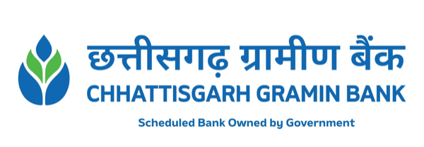<br/>`PNG` | — |
| [Citibank](./assets/logos/citi/) | `citi` | — | <br/>`PNG` |
| [City Union Bank](./assets/logos/ciub/) | `ciub` | <br/>`SVG` `PNG` | <br/>`SVG` `PNG` |
| [Capital Small Finance Bank](./assets/logos/clbl/) | `clbl` | <br/>`PNG` | — |
| [Canara Bank](./assets/logos/cnrb/) | `cnrb` | <br/>`SVG` `PNG` | <br/>`SVG` `PNG` |
| [Credit Suisse AG](./assets/logos/cres/) | `cres` | — | <br/>`PNG` |
| [Credit Agricole Corporate and Investment Bank](./assets/logos/crly/) | `crly` | — | <br/>`PNG` |
| [CSB Bank Limited](./assets/logos/csbk/) | `csbk` | <br/>`SVG` `PNG` | <br/>`SVG` `PNG` |
| [CTBC Bank Co., Ltd.](./assets/logos/ctcb/) | `ctcb` | <br/>`PNG` | — |
| [DBS Bank India Limited](./assets/logos/dbss/) | `dbss` | — | <br/>`PNG` |
| [DCB Bank Limited](./assets/logos/dcbl/) | `dcbl` | <br/>`SVG` `PNG` | <br/>`SVG` `PNG` |
| [Deutsche Bank](./assets/logos/deut/) | `deut` | — | <br/>`PNG` |
| [Dhanalakshmi Bank](./assets/logos/dlxb/) | `dlxb` | <br/>`SVG` `PNG` | <br/>`SVG` `PNG` |
| [Doha Bank](./assets/logos/dohb/) | `dohb` | — | <br/>`PNG` |
| [Emirates NBD Bank](./assets/logos/ebil/) | `ebil` | — | <br/>`PNG` |
| [Equitas Small Finance Bank](./assets/logos/esfb/) | `esfb` | 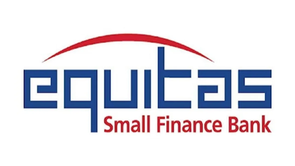<br/>`PNG` | — |
| [ESAF Small Finance Bank](./assets/logos/esmf/) | `esmf` | <br/>`SVG` `PNG` | <br/>`SVG` `PNG` |
| [Federal Bank](./assets/logos/fdrl/) | `fdrl` | <br/>`SVG` `PNG` | <br/>`SVG` `PNG` |
| [FINO Payments Bank](./assets/logos/fino/) | `fino` | <br/>`SVG` `PNG` | <br/>`SVG` `PNG` |
| [FirstRand Bank](./assets/logos/firn/) | `firn` | — | <br/>`PNG` |
| [Gujarat Gramin Bank](./assets/logos/gujarat-gramin/) | `gujarat-gramin` | 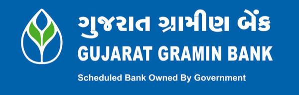<br/>`PNG` | — |
| [Haryana Gramin Bank](./assets/logos/haryana-gramin/) | `haryana-gramin` | 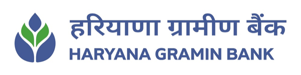<br/>`PNG` | — |
| [HDFC Bank](./assets/logos/hdfc/) | `hdfc` | <br/>`SVG` `PNG` | <br/>`SVG` `PNG` |
| [Himachal Pradesh Gramin Bank](./assets/logos/himachal-gramin/) | `himachal-gramin` | 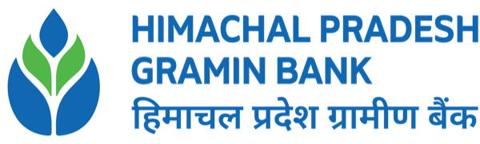<br/>`PNG` | — |
| [HSBC Limited](./assets/logos/hsbc/) | `hsbc` | — | <br/>`PNG` |
| [Woori Bank](./assets/logos/hvbk/) | `hvbk` | — | <br/>`PNG` |
| [PT Bank Maybank Indonesia Tbk](./assets/logos/ibbk/) | `ibbk` | — | <br/>`PNG` |
| [IDBI Bank](./assets/logos/ibkl/) | `ibkl` | <br/>`SVG` `PNG` | <br/>`SVG` `PNG` |
| [Industrial Bank of Korea](./assets/logos/ibko/) | `ibko` | — | <br/>`PNG` |
| [Industrial and Commercial Bank of China Limited](./assets/logos/icbk/) | `icbk` | — | <br/>`PNG` |
| [ICICI Bank Limited](./assets/logos/icic/) | `icic` | <br/>`SVG` `PNG` | <br/>`SVG` `PNG` |
| [IDFC First Bank Limited](./assets/logos/idfb/) | `idfb` | <br/>`SVG` `PNG` | <br/>`SVG` `PNG` |
| [Indian Bank](./assets/logos/idib/) | `idib` | <br/>`SVG` `PNG` | <br/>`SVG` `PNG` |
| [IndusInd Bank](./assets/logos/indb/) | `indb` | <br/>`SVG` `PNG` | <br/>`SVG` `PNG` |
| [Indian Overseas Bank](./assets/logos/ioba/) | `ioba` | <br/>`SVG` `PNG` | <br/>`SVG` `PNG` |
| [India Post Payments Bank](./assets/logos/ipos/) | `ipos` | — | <br/>`PNG` |
| [Jammu and Kashmir Bank](./assets/logos/jaka/) | `jaka` | <br/>`SVG` `PNG` | <br/>`SVG` `PNG` |
| [Jharkhand Gramin Bank](./assets/logos/jharkhand-gramin/) | `jharkhand-gramin` | 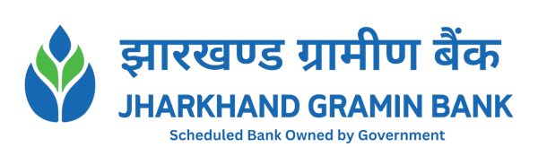<br/>`PNG` | — |
| [Jio Payments Bank](./assets/logos/jiop/) | `jiop` | <br/>`SVG` `PNG` | <br/>`SVG` `PNG` |
| [Jana Small Finance Bank](./assets/logos/jsfb/) | `jsfb` | 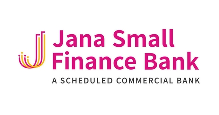<br/>`PNG` | — |
| [Karnataka Bank Limited](./assets/logos/karb/) | `karb` | <br/>`SVG` `PNG` | <br/>`SVG` `PNG` |
| [Karnataka Grameena Bank](./assets/logos/karnataka-grameena/) | `karnataka-grameena` | 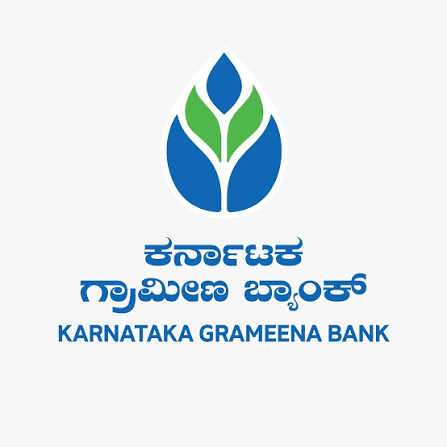<br/>`PNG` | — |
| [Kookmin Bank](./assets/logos/kbkb/) | `kbkb` | — | <br/>`PNG` |
| [Kerala Grameena Bank](./assets/logos/kerala-grameena/) | `kerala-grameena` | 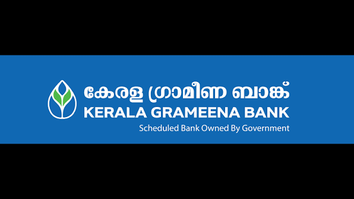<br/>`PNG` | — |
| [Kotak Mahindra Bank Limited](./assets/logos/kkbk/) | `kkbk` | <br/>`SVG` `PNG` | <br/>`SVG` `PNG` |
| [KEB Hana Bank](./assets/logos/koex/) | `koex` | — | <br/>`PNG` |
| [Krung Thai Bank Public Company Limited](./assets/logos/krth/) | `krth` | — | <br/>`PNG` |
| [Karur Vysya Bank](./assets/logos/kvbl/) | `kvbl` | <br/>`SVG` `PNG` | <br/>`SVG` `PNG` |
| [Maharashtra Gramin Bank](./assets/logos/maharashtra-gramin/) | `maharashtra-gramin` | 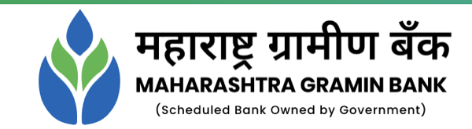<br/>`PNG` | — |
| [Bank of Maharashtra](./assets/logos/mahb/) | `mahb` | <br/>`SVG` `PNG` | <br/>`SVG` `PNG` |
| [Manipur Rural Bank](./assets/logos/manipur-rural/) | `manipur-rural` | <br/>`PNG` | — |
| [Mizuho Bank Ltd](./assets/logos/mhcb/) | `mhcb` | — | <br/>`PNG` |
| [Mizoram Rural Bank](./assets/logos/mizoram-rural/) | `mizoram-rural` | 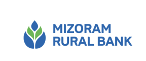<br/>`PNG` | — |
| [Madhya Pradesh Gramin Bank](./assets/logos/mp-gramin/) | `mp-gramin` | <br/>`PNG` | — |
| [Nagaland Rural Bank](./assets/logos/nagaland-rural/) | `nagaland-rural` | <br/>`PNG` | — |
| [NatWest Markets Plc](./assets/logos/natwest/) | `natwest` | 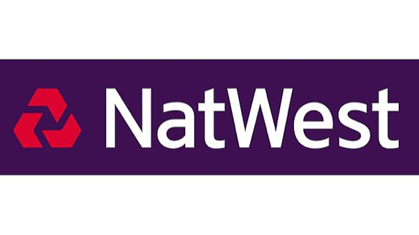<br/>`PNG` | — |
| [First Abu Dhabi Bank PJSC](./assets/logos/nbad/) | `nbad` | — | <br/>`PNG` |
| [Slice Small Finance Bank](./assets/logos/nesf/) | `nesf` | <br/>`PNG` | — |
| [NongHyup Bank](./assets/logos/nhba/) | `nhba` | <br/>`PNG` | — |
| [Bank of Nova Scotia](./assets/logos/nosc/) | `nosc` | — | <br/>`PNG` |
| [The Nainital Bank Limited](./assets/logos/ntbl/) | `ntbl` | <br/>`SVG` `PNG` | <br/>`SVG` `PNG` |
| [Odisha Grameen Bank](./assets/logos/odisha-grameen/) | `odisha-grameen` | 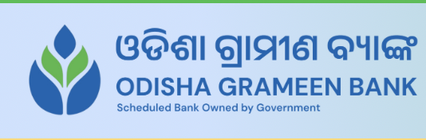<br/>`PNG` | — |
| [Punjab and Sind Bank](./assets/logos/psib/) | `psib` | <br/>`SVG` `PNG` | <br/>`SVG` `PNG` |
| [Puducherry Grama Bank](./assets/logos/puducherry-grama/) | `puducherry-grama` | 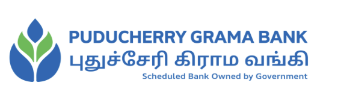<br/>`PNG` | — |
| [Punjab National Bank](./assets/logos/punb/) | `punb` | <br/>`SVG` `PNG` | <br/>`SVG` `PNG` |
| [Punjab Gramin Bank](./assets/logos/punjab-gramin/) | `punjab-gramin` | 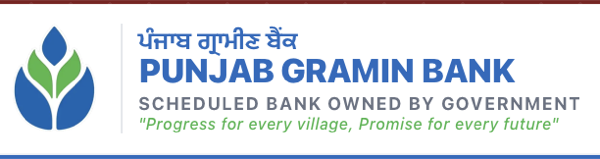<br/>`PNG` | — |
| [Paytm Payments Bank](./assets/logos/pytm/) | `pytm` | <br/>`SVG` `PNG` | <br/>`SVG` `PNG` |
| [Qatar National Bank](./assets/logos/qnba/) | `qnba` | — | <br/>`PNG` |
| [Cooperatieve Rabobank U.A.](./assets/logos/rabo/) | `rabo` | — | <br/>`PNG` |
| [Rajasthan Gramin Bank](./assets/logos/rajasthan-gramin/) | `rajasthan-gramin` | 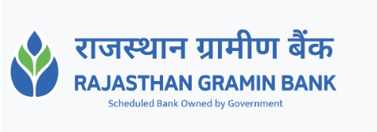<br/>`PNG` | — |
| [RBL Bank Limited](./assets/logos/ratn/) | `ratn` | <br/>`SVG` `PNG` | <br/>`SVG` `PNG` |
| [Sberbank](./assets/logos/sabr/) | `sabr` | — | <br/>`PNG` |
| [State Bank of India](./assets/logos/sbin/) | `sbin` | <br/>`SVG` `PNG` | <br/>`SVG` `PNG` |
| [Standard Chartered Bank](./assets/logos/scbl/) | `scbl` | <br/>`SVG` `PNG` | <br/>`SVG` `PNG` |
| [Shinhan Bank](./assets/logos/shbk/) | `shbk` | — | <br/>`PNG` |
| [South Indian Bank](./assets/logos/sibl/) | `sibl` | <br/>`SVG` `PNG` | <br/>`SVG` `PNG` |
| [Sumitomo Mitsui Banking Corporation](./assets/logos/smbc/) | `smbc` | — | <br/>`PNG` |
| [Shivalik Small Finance Bank](./assets/logos/smcb/) | `smcb` | <br/>`PNG` | — |
| [Societe Generale](./assets/logos/soge/) | `soge` | — | <br/>`PNG` |
| [Sonali Bank PLC](./assets/logos/sonali-bank/) | `sonali-bank` | 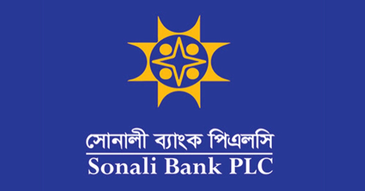<br/>`PNG` | — |
| [Suryoday Small Finance Bank](./assets/logos/srcb/) | `srcb` | 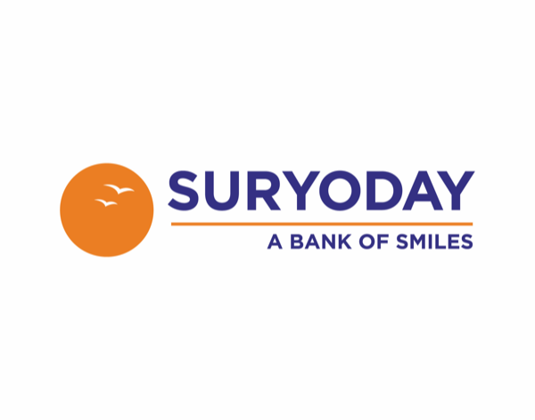<br/>`PNG` | — |
| [SBM Bank (India) Limited](./assets/logos/stcb/) | `stcb` | <br/>`PNG` | — |
| [Tamil Nadu Grama Bank](./assets/logos/tamilnadu-grama/) | `tamilnadu-grama` | 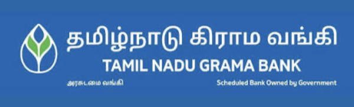<br/>`PNG` | — |
| [Tamilnad Mercantile Bank Limited](./assets/logos/tmbl/) | `tmbl` | <br/>`SVG` `PNG` | <br/>`SVG` `PNG` |
| [Tripura Gramin Bank](./assets/logos/tripura-gramin/) | `tripura-gramin` | 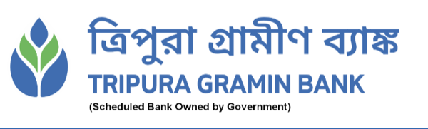<br/>`PNG` | — |
| [Union Bank of India](./assets/logos/ubin/) | `ubin` | <br/>`SVG` `PNG` | <br/>`SVG` `PNG` |
| [UBS AG](./assets/logos/ubsw/) | `ubsw` | <br/>`PNG` | — |
| [UCO Bank](./assets/logos/ucba/) | `ucba` | <br/>`SVG` `PNG` | <br/>`SVG` `PNG` |
| [Ujjivan Small Finance Bank Ltd](./assets/logos/ujvn/) | `ujvn` | <br/>`SVG` `PNG` | <br/>`SVG` `PNG` |
| [Unity Small Finance Bank](./assets/logos/unba/) | `unba` | <br/>`PNG` | — |
| [United Overseas Bank Limited](./assets/logos/uovb/) | `uovb` | — | <br/>`PNG` |
| [Uttar Pradesh Gramin Bank](./assets/logos/up-gramin/) | `up-gramin` | 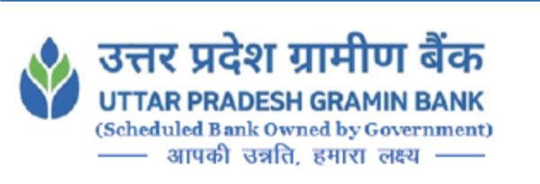<br/>`PNG` | — |
| [Axis Bank](./assets/logos/utib/) | `utib` | <br/>`SVG` `PNG` | <br/>`SVG` `PNG` |
| [Utkarsh Small Finance Bank](./assets/logos/utks/) | `utks` | <br/>`PNG` | — |
| [Uttarakhand Gramin Bank](./assets/logos/uttarakhand-gramin/) | `uttarakhand-gramin` | 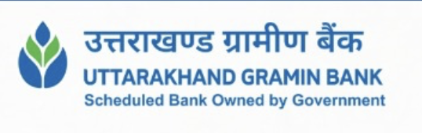<br/>`PNG` | — |
| [JSC VTB Bank](./assets/logos/vtbj/) | `vtbj` | 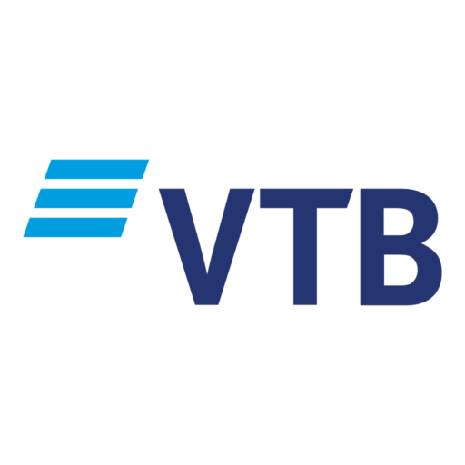<br/>`PNG` | — |
| [West Bengal Gramin Bank](./assets/logos/wb-gramin/) | `wb-gramin` | 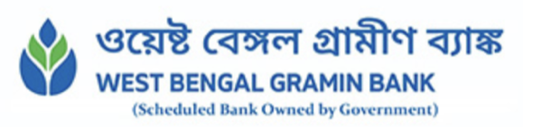<br/>`PNG` | — |
| [Westpac Banking Corporation](./assets/logos/wpac/) | `wpac` | — | <br/>`PNG` |
| [Yes Bank](./assets/logos/yesb/) | `yesb` | <br/>`SVG` `PNG` | <br/>`SVG` `PNG` |
<!-- BANKS_TABLE_END -->

## Optimizing & Converting

Optimize SVGs (preserves `viewBox`):

```sh
pnpm install
pnpm run optimize
```

Convert SVGs to PNG or AVIF. By default, writes 1x PNGs alongside each SVG in `assets/logos/`:

```sh
pnpm run convert
```

We ship 1x PNGs alongside every SVG. If you need AVIF or higher-density variants, pass a format, scale factor, and output directory:

```sh
# 2x AVIFs into ./dist
pnpm run convert -- --format avif --scale 2 --out dist
```

**Flags**

| Flag              | Values       | Default           | Notes                                        |
| ----------------- | ------------ | ----------------- | -------------------------------------------- |
| `-f`, `--format`  | `png`, `avif`| `png`             |                                              |
| `-s`, `--scale`   | `1`, `2`, `3`| `1`               | 1x uses intrinsic SVG dimensions             |
| `-o`, `--out`     | any dir      | `assets/logos/`   | If omitted, overwrites files in the repo     |

Output is named `logo.png` at 1x, `logo@2x.png` at 2x, `logo@3x.png` at 3x (and the same pattern for AVIF).

## Contributors
<a href="https://github.com/praveenpuglia/indian-banks/graphs/contributors">
  
</a>

Made with [contrib.rocks](https://contrib.rocks).
